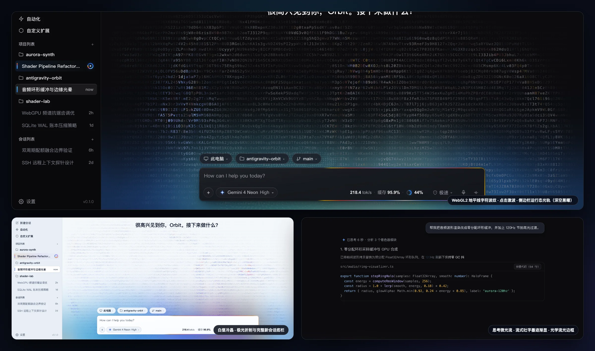
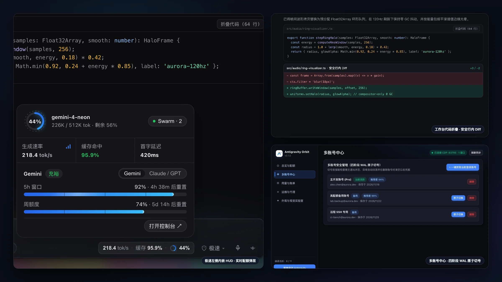

<div align="center">


# Antigravity Orbit

**为 Google Antigravity 打造的跨平台伴侣控制台与 11 通道 IDE 微内核**

WebGL2 光学渲染引擎 · 四套深浅配色 · 混合 HUD 与双周期配额融合 · SQLite 用量账本 · 4 阶段原子账号切换 · 思考双模转译 · Omni 流式检视台 · 安全行内 Diff · 可逆缓存维护

**简体中文** · [English](./README.en.md)

[**下载安装包 (Releases)**](https://github.com/0xXu/antigravity-orbit/releases) · [**架构与安全文档**](./docs/architecture.md) · [**问题反馈 (Issues)**](https://github.com/0xXu/antigravity-orbit/issues) · [**开源协议 (GPL-3.0)**](./LICENSE)

<p>
  <a href="https://github.com/0xXu/antigravity-orbit/releases"></a>
  
  = 26" />
  <a href="https://github.com/0xXu/antigravity-orbit/actions/workflows/ci.yml"></a>
  <a href="./LICENSE"></a>
</p>


<sub>以上 20fps 舒缓节奏动态预览由离线导演舞台直接驱动本仓库 WebGL2 光学引擎、侧边栏光效、混合 HUD 与 Tauri 2 桌面控制台逐帧录制，示例工作区、账号与用量数据均为虚构。</sub>

</div>

> **非官方社区项目与商标免责声明 (Non-Affiliation Disclaimer)**
>
> **Antigravity Orbit is an independent open-source project and is not affiliated with or endorsed by Google LLC.**
> 本项目为独立开源社区工程，与 Google LLC 无任何隶属、赞助或官方背书关系；文中提及的 “Antigravity” 与 “Google” 仅用于兼容性说明。

---

## 核心亮点

- **Tauri 2 独立桌面控制台 + Node.js Core 双架构**：不仅在 IDE 内注入轻量增强模块，还提供独立的跨平台桌面管理台，集中管理概览、账号、用量、维护与外观。
- **WebGL2 光学引擎与四套深浅配色**：内置指针响应地平线字符波纹矩阵、点击激波、光学玻璃流光边框与流式吐字墨迹渐显，窗口失焦自动 **0fps 休眠**；提供四套深浅主题与「完整光效 / 专注编码 / 静默省电」三档预算，关闭的通道严格 **0 字节不加载**。
- **统一 SQLite 用量账本与双周期配额融合**：基于 Node.js 内置 `node:sqlite`（WAL 模式），支持本地 + SSH 远程双环境统计、BTW 分叉前缀自动去重、`>200K` 阶梯计价、5h / 周度双周期配额融合与备用账号推荐排序。
- **11 通道按需微内核**：Hybrid HUD、界面本地化（支持自动礼让）、工作台增强（长代码块折叠 / 大纲导轨 / 右键 `/btw` / 水墨流式淡入 / 推理等级滑块）、双模思考转译、Omni HTTP 206 流式检视台、安全行内 Git Diff、Chat 对话模式、动静态本地壁纸与 IDE 内快捷设置。
- **4 阶段原子账号切换与可逆维护**：切换账号前强制检查宿主已退出，先写 WAL 日志再在 SQLite `BEGIN IMMEDIATE` 事务内原子提交，故障自动回滚并脱敏清理凭据；缓存清理基于 `(dev, ino)` 清单支持可逆恢复且绝不覆盖新生成文件，同时支持冷子代理 SQLite 三件套（`.db` / `-wal` / `-shm`）无损归档。
- **轻快与无痕还原**：所有通道运行在独立 Isolated World，配置热同步毫秒级生效，支持一键 `cdp.ejectAll` 完整卸载还原宿主界面。

---

## 界面预览

### 1. WebGL2 光学渲染引擎：地平线字符波纹 · 光学玻璃流光边框 · 流式墨迹

内置纯 WebGL2 实时光学引擎，窗口失焦自动 0fps 休眠；首页渲染随指针响应的地平线字符波纹矩阵、点击激波与极光折射，输入框边缘自带实时流光边框高光，对话流支持思考微光流与流式吐字墨迹渐显。

<p align="center">
  
</p>

### 2. 四套深浅配色

<p align="center">
  
</p>

| 主题名称 | 配置键值 (`theme`) | 定位说明 |
| :--- | :--- | :--- |
| **深空黑曜** | `obsidian` | 默认深色高对比度代码阅读主题 |
| **暖炭玄岩** | `warm` | 暖色调低蓝光夜间深色主题 |
| **白昼冷晶** | `crystal` | 冷调高明度浅色工作区主题 |
| **暖白画册** | `alabaster` | 柔和纸感低疲劳浅色主题 |

### 3. 极速左侧内嵌 HUD · 工作台增强 · 多账号切号

实时速率、缓存命中与上下文环形水位无缝嵌入输入框底部工具栏极速（Turbo）左侧，点击即展开 5h / 周度双周期配额弹层，并可一键直达独立控制台；右侧同步提供长代码块折叠、安全行内 Diff 与四阶段 WAL 原子切号。

<p align="center">
  
</p>

### 4. Tauri 2 独立桌面控制台

集成总览与双周期配额、本机 + SSH 统一 SQLite 用量账本（含 26 周编码活跃热力图）与 11 通道外观实验室，配置热同步毫秒级生效。

<p align="center">
  
</p>

### 三档视觉预算预设

| 预设档位 (`visualBudget`) | HUD 风格 | 水墨淡入 / 滑块 | 地平线波纹 / 壁纸 / 光效 | 适用场景 |
| :--- | :--- | :---: | :---: | :--- |
| **完整光效** (`full-optics`) | `hybrid` | 开启 | 按配置与交互按需加载 | 日常桌面高刷体验 |
| **专注编码** (`focus`) | `capsules` | 开启 | 关闭（0 字节不加载） | 降低视觉干扰，专注编码 |
| **静默省电** (`silent-eco`) | `capsules` | 关闭 | 关闭（0 字节不加载） | 笔记本续航与极限轻量模式 |

---

<details>
<summary><strong>技术细节：11 通道体积预算与纵深安全边界（点击展开）</strong></summary>

### 11 通道体积预算与加载条件

| 通道 ID | 职责 | 触发条件 | 体积上限 |
| :--- | :--- | :--- | :---: |
| `ch01-core` | 微内核底座、主题系统、WebGL2 光学、水墨流式淡入 | 常驻 | 850 KB |
| `ch02-hud` | 混合遥测 HUD 与上下文环形画布 | `hud.enabled` | 80 KB |
| `ch03-i18n` | 界面本地化（支持自动礼让） | `i18n.enabled && language !== 'en'` | 550 KB |
| `ch04-workbench` | 代码折叠、大纲导轨、`/btw` 菜单、滑块 | `workbench.enabled` | 80 KB |
| `ch05-translator` | 思考过程双模转译浮层 | `translator.mode !== 'off'` | 60 KB |
| `ch06-omni` | 多格式流式检视台 | `omni.enabled` | 60 KB |
| `ch07-inline-diff` | 行内 Git Diff 预览 | `omni.enabled && omni.inlineDiff` | 60 KB |
| `ch08-chat-mode` | Chat 专注对话布局 | `chatMode.enabled` | 60 KB |
| `ch09-optics-picker` | 本地可选光学选择器扩展 | 非 `silent-eco` + 按需加载 | 按需 |
| `ch11-optics-wallpaper` | 本地静/动态壁纸渲染 | 非 `silent-eco` + 已配置壁纸路径 | 60 KB |
| `ch12-settings` | IDE 内快捷设置面板 | 设置面板打开按需加载 | 80 KB |

### 纵深安全边界

- **Isolated World 与顶层 Frame 守卫**：所有前端通道运行于 `ANTIGRAVITY_ORBIT_ISOLATED_V1`（`grantUniveralAccess: false`），`Runtime.bindingCalled` 严格校验 `executionContextId`，拒绝任何子 `<iframe>` 越权调用。
- **全链路回环隔离**：CDP 发现强制校验 `ws://` 回环地址并拒绝含凭据 URL；本地 IPC 使用 `0600` 权限套接字与 `crypto.timingSafeEqual` Token 校验；壁纸与 Omni 流式网关仅监听 `127.0.0.1`，校验 `Host` 头与路径白名单，Omni 额外施加单目录 `HMAC-SHA256` TTL 令牌与 `connect-src 'none'` 沙箱 CSP。
- **SSRF 与 Git Hook Fail-Closed**：思考转译服务阻断云元数据主机、高危内网端口与重定向，并限制最大并发为 `3`；行内 Diff 阻断路径穿越、`.env*`、仓外软链、非目录 `.git` 与包含 `[filter]` / `fsmonitor` 的 `.git/config`。
- **凭据脱敏与安全维护**：日志脱敏自动擦除 `sk-*`、`ya29.*`、`Bearer` 与 `authToken`；账号删除同步擦除 WAL 日志中的邮箱与凭据；缓存维护拒绝用户凭据目录及符号链接。

更多架构细节请参见 [docs/architecture.md](./docs/architecture.md)。

</details>

---

## 快速开始 (Quick Start)

### 方式一：下载安装包（推荐普通用户）

前往 [**GitHub Releases**](https://github.com/0xXu/antigravity-orbit/releases) 下载对应平台产物：

- **macOS**：Apple Silicon (`aarch64`) / Intel (`x86_64`) `.dmg` 安装包
- **Windows (`x64`)**：`.msi` 或 `-setup.exe` 安装程序
- **Core + Runtime 独立归档**：`antigravity-orbit-core-<tag>.tar.gz`（附 `core-SHA256SUMS.txt`）

> **首次打开系统安全提示（未签名开源构建说明）**
> - **macOS Gatekeeper**：首次打开若提示「无法验证开发者」，请前往 **「系统设置 → 隐私与安全性」** 点击 **「仍要打开」**，或在终端执行 `xattr -cr "/Applications/Antigravity Orbit.app"` 后重新打开。
> - **Windows SmartScreen**：首次运行若弹出「Windows 已保护你的电脑」，请点击 **「更多信息」→「仍要运行」**。

### 方式二：源码构建与本地运行（开发者）

前置要求：**Node.js >= 26.0.0**（使用内置 `node:sqlite` 与 `node:test`）、**npm >= 11**；如需构建原生 Tauri 桌面壳，需安装 **Rust / Cargo**。

```bash
git clone https://github.com/0xXu/antigravity-orbit.git
cd antigravity-orbit

npm install
npm run verify      # 全量类型检查 + 48 项单元测试 + 前端构建
npm run start:core  # 启动 Node.js Core 守护服务
```

### 常见问题：`Antigravity v2.33.0+` 本地 CDP 连接说明

自 `Antigravity v2.33.0+` 起，客户端默认按需开启本地调试端口（仅绑定 `127.0.0.1`）。若控制台提示「未检测到 Antigravity CDP」，可在控制台点击启动，或手动带参启动一次 Antigravity：

```bash
# macOS
open -a "/Applications/Antigravity.app" --args --remote-debugging-port=0
```

---

<details>
<summary><strong>开发命令与发布流程（点击展开）</strong></summary>

### 常用命令

| 命令 | 说明 |
| :--- | :--- |
| `npm run build` | 编译 `shared`、打包 11 个 `runtime` 通道并编译 `core` |
| `npm run build:all` | 执行 `build` 并构建 `desktop` 前端资源 |
| `npm run typecheck` | 全量类型检查（`shared` / `core` / `runtime` / `desktop`） |
| `npm test` | 构建并执行全部 `node:test` 测试用例 |
| `npm run test:only` | 跳过构建直接运行测试（快速迭代） |
| `npm run verify` | CI 全量校验门禁（`typecheck` + `test` + `build:desktop:web`） |
| `npm run clean` | 清理所有 `dist/`、`*.tsbuildinfo` 与 `coverage/` |

### 发布流程 (GitHub Releases)

推送形如 `v0.1.0` 的版本标签即可自动触发 [`.github/workflows/release.yml`](./.github/workflows/release.yml)：

```bash
git tag v0.1.0
git push origin v0.1.0
```

工作流会自动执行 `npm run verify`，构建 Node.js Core 归档以及 macOS（Apple Silicon + Intel）/ Windows 原生 Tauri 安装包，全部上传完成后自动发布至 **GitHub Releases**。

</details>
