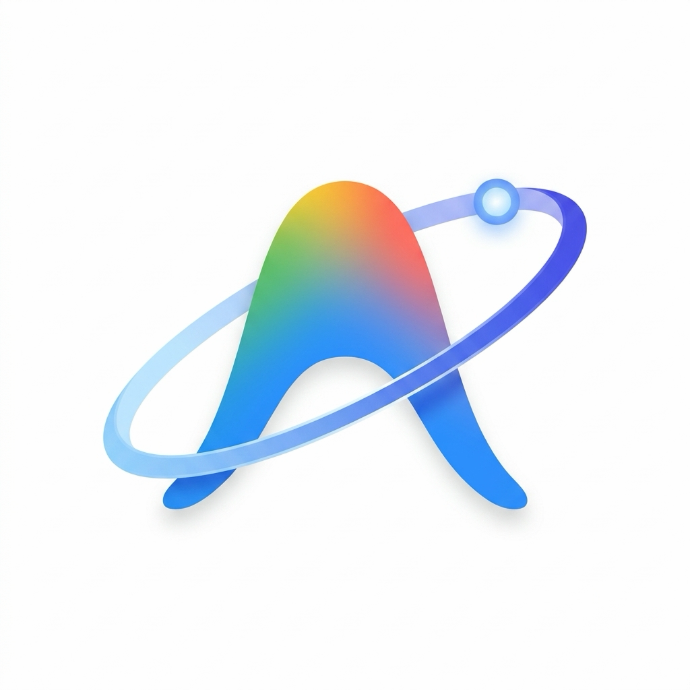
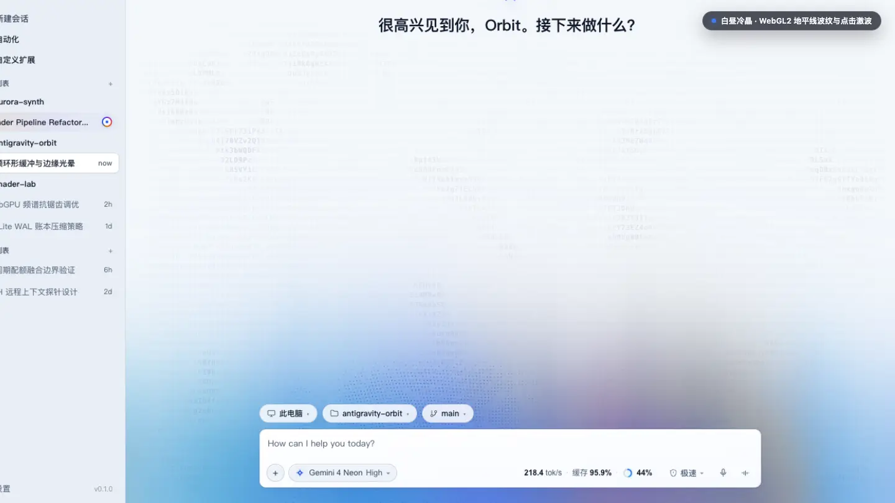
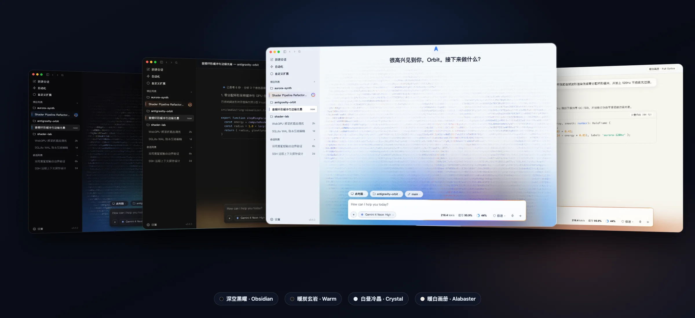
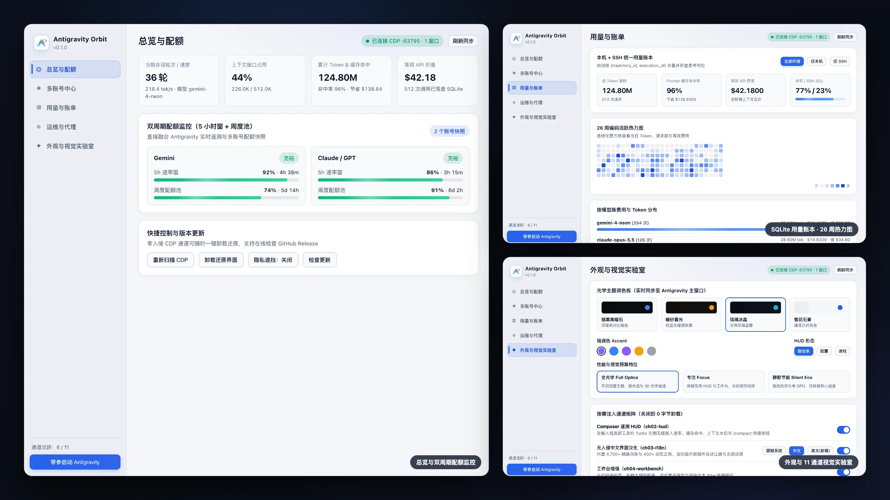

<div align="center">



# Antigravity Orbit

**Cross-platform Companion Console & 11-Channel On-Demand IDE Microkernel for Google Antigravity**

WebGL2 Optics Engine · 4 Light/Dark Palettes · Hybrid HUD & Dual-Period Quota Fusion · Unified SQLite Ledger · 4-Phase Atomic Account Switching · Dual-Mode Thought Translation · Omni Streaming Inspector · Safe Inline Git Diff · Reversible Cache Maintenance

**English** · [简体中文](./README.zh-CN.md)

[**Download Releases**](https://github.com/0xXu/antigravity-orbit/releases) · [**Architecture & Security**](./docs/architecture.md) · [**Issues**](https://github.com/0xXu/antigravity-orbit/issues) · [**License (GPL-3.0)**](./LICENSE)

<p>
  <a href="https://github.com/0xXu/antigravity-orbit/releases"></a>
  
  = 26" />
  <a href="https://github.com/0xXu/antigravity-orbit/actions/workflows/ci.yml"></a>
  <a href="./LICENSE"></a>
</p>



<sub>Recorded frame-by-frame at 24fps from an offline director stage running this repository's real WebGL2 Optics Engine, sidebar luminous indicators, Hybrid HUD, and Tauri 2 Desktop Console. All sample workspaces, accounts, and usage figures are fictional.</sub>

</div>

> **Non-Affiliation Disclaimer**
>
> **Antigravity Orbit is an independent open-source project and is not affiliated with or endorsed by Google LLC.**
> References to "Antigravity" and "Google" are solely for compatibility descriptions.

---

## Highlights

- **Tauri 2 Native Desktop Console + Node.js Core Architecture**: Injects lightweight on-demand channels into the IDE while providing a standalone cross-platform desktop console for overview, multi-account management, usage analytics, maintenance, and visual tuning.
- **WebGL2 Optics Engine & 4 Light/Dark Palettes**: Features pointer-reactive horizon character ripple matrices, click shockwaves, optical glass rim highlights, streaming ink fade, and automatic **0fps blur sleep**. Ships with 4 curated light/dark palettes and 3 visual budget presets (`full-optics` / `focus` / `silent-eco`) where disabled channels load **strictly 0 bytes**.
- **Unified SQLite Usage Ledger & Dual-Period Quota Fusion**: Built on Node.js native `node:sqlite` (WAL mode) with unified Local + Remote SSH tracking, automatic BTW fork-prefix deduplication, `>200K` tiered context pricing, 5h / weekly quota fusion, and standby account recommendation scoring.
- **11-Channel On-Demand Microkernel**: Hybrid HUD, non-invasive UI localization (with automatic host yield), workbench enhancements (long code folding / outline rail / right-click `/btw` / streaming ink fade / effort slider), dual-mode thought translation, Omni HTTP 206 streaming inspector, safe inline Git Diff, Chat focus mode, local static/animated wallpaper renderer, and quick IDE settings.
- **4-Phase Atomic Account Switching & Reversible Maintenance**: Enforces host-stopped verification before switching, writes WAL logs, commits atomically inside SQLite `BEGIN IMMEDIATE` transactions with automatic rollback and credential scrubbing on delete. Cache cleanup tracks `(dev, ino)` manifests for lossless undo without ever overwriting newly generated files, plus lossless archival of cold subagent SQLite triplets (`.db` / `-wal` / `-shm`).
- **Lightweight & Cleanly Reversible**: Every channel runs inside an Isolated World with millisecond hot-sync configuration and one-click `cdp.ejectAll` full teardown.

---

## Visual Preview

### 1. WebGL2 Optics Engine: Horizon Ripple Matrix · Optical Glass Rim · Streaming Ink

Powered by a pure WebGL2 real-time optics renderer with automatic 0fps window-blur sleep. The New Session canvas renders pointer-reactive horizon character ripples, click shockwaves, and aurora refraction; the composer casts a live specular optical rim glow, and conversations render animated thinking shimmers alongside smooth streaming ink fade.

<p align="center">
  
</p>

### 2. Four Curated Light & Dark Palettes

<p align="center">
  
</p>

| Theme Name | Config Key (`theme`) | Description |
| :--- | :--- | :--- |
| **Obsidian** | `obsidian` | Default high-contrast dark theme for crisp code readability |
| **Warm** | `warm` | Low-blue-light warm charcoal palette for late-night sessions |
| **Crystal** | `crystal` | Cool, luminous daylight workspace theme |
| **Alabaster** | `alabaster` | Soft, low-fatigue warm paper light theme |

### 3. Inline Hybrid HUD · Workbench Enhancements · Multi-Account Switching

Real-time throughput (`tok/s`), prompt cache hit rate, and a radial context gauge embed seamlessly left of the composer's Turbo/Permissions trigger. Click to reveal the 5h / weekly dual-period quota popover or jump straight into the Desktop Console. Paired with long code block folding, safe inline Git Diff, and 4-phase WAL atomic account switching.

<p align="center">
  
</p>

### 4. Tauri 2 Standalone Desktop Console

Unifies dual-period quota overview, Local + SSH SQLite usage ledger (with a 26-week coding activity heatmap), and the 11-channel Appearance & Visual Lab with instant hot-sync to live IDE windows.

<p align="center">
  
</p>

### Visual Budget Presets

| Preset (`visualBudget`) | HUD Style | Ink Fade / Effort Slider | Horizon Ripple / Wallpaper / Optics | Best For |
| :--- | :--- | :---: | :---: | :--- |
| **Full Optics** (`full-optics`) | `hybrid` | On | On-demand per config & interaction | High-refresh desktop experience |
| **Focus** (`focus`) | `capsules` | On | Off (0 bytes loaded) | Distraction-free coding |
| **Silent Eco** (`silent-eco`) | `capsules` | Off | Off (0 bytes loaded) | Maximum battery life & minimal footprint |

---

<details>
<summary><strong>Technical Details: 11-Channel Size Budgets & Defense-in-Depth Security (Click to expand)</strong></summary>

### 11-Channel Budgets & Load Conditions

| Channel ID | Responsibility | Load Condition | Budget Cap |
| :--- | :--- | :--- | :---: |
| `ch01-core` | Microkernel base, theme system, WebGL2 optics, streaming ink fade | Always on | 850 KB |
| `ch02-hud` | Hybrid telemetry HUD & context ring canvas | `hud.enabled` | 80 KB |
| `ch03-i18n` | Non-invasive UI localization (with host auto-yield) | `i18n.enabled && language !== 'en'` | 550 KB |
| `ch04-workbench` | Code folding, outline rail, `/btw` context menu, effort slider | `workbench.enabled` | 80 KB |
| `ch05-translator` | Dual-mode thought process translation overlay | `translator.mode !== 'off'` | 60 KB |
| `ch06-omni` | Multi-format HTTP 206 streaming inspector | `omni.enabled` | 60 KB |
| `ch07-inline-diff` | Safe inline Git Diff preview | `omni.enabled && omni.inlineDiff` | 60 KB |
| `ch08-chat-mode` | Focused Chat conversation layout | `chatMode.enabled` | 60 KB |
| `ch09-optics-picker` | Optional local optical picker extension | Non-`silent-eco` + on-demand | On-demand |
| `ch11-optics-wallpaper` | Local static / animated wallpaper renderer | Non-`silent-eco` + wallpaper path set | 60 KB |
| `ch12-settings` | In-IDE quick settings panel | Settings panel opened | 80 KB |

### Defense-in-Depth Security Boundaries

- **Isolated World & Top-Frame Guard**: All runtime channels execute inside `ANTIGRAVITY_ORBIT_ISOLATED_V1` (`grantUniveralAccess: false`). `Runtime.bindingCalled` strictly validates `executionContextId`, rejecting calls from any child `<iframe>`.
- **Full-Stack Loopback Isolation**: CDP discovery enforces loopback `ws://` URLs and rejects embedded credentials; local IPC uses `0600` private sockets with `crypto.timingSafeEqual` token verification; Wallpaper and Omni streaming gateways bind strictly to `127.0.0.1` with `Host` header & path allowlist checks, plus per-directory `HMAC-SHA256` TTL tokens and `connect-src 'none'` sandbox CSP for Omni.
- **Fail-Closed SSRF & Git Hook Protection**: Thought translation blocks cloud metadata hosts, high-risk internal ports, and redirects (max concurrency `3`); inline Diff blocks path traversal, `.env*`, outside symlinks, non-directory `.git`, and `.git/config` files containing `[filter]` or `fsmonitor`.
- **Credential Scrubbing & Safe Maintenance**: Log redaction automatically strips `sk-*`, `ya29.*`, `Bearer`, and `authToken`; account deletion scrubs emails and credentials from WAL logs; cache maintenance rejects credential directories and symlinks.

For full architectural details, see [docs/architecture.md](./docs/architecture.md).

</details>

---

## Quick Start

### Option 1: Download Installer (Recommended)

Download the prebuilt package for your platform from [**GitHub Releases**](https://github.com/0xXu/antigravity-orbit/releases):

- **macOS**: Apple Silicon (`aarch64`) / Intel (`x86_64`) `.dmg` installer
- **Windows (`x64`)**: `.msi` or `-setup.exe` installer
- **Standalone Core + Runtime Archive**: `antigravity-orbit-core-<tag>.tar.gz` (with `core-SHA256SUMS.txt`)

> **First-Launch OS Notice (Unsigned Open-Source Builds)**
> - **macOS Gatekeeper**: If macOS reports an unverified developer, go to **System Settings → Privacy & Security** and click **Open Anyway**, or run `xattr -cr "/Applications/Antigravity Orbit.app"` in Terminal.
> - **Windows SmartScreen**: If prompted by Windows Defender SmartScreen, click **More info → Run anyway**.

### Option 2: Build from Source (Developers)

Requirements: **Node.js >= 26.0.0** (uses built-in `node:sqlite` and `node:test`), **npm >= 11**, and **Rust / Cargo** if building the native Tauri 2 desktop shell.

```bash
git clone https://github.com/0xXu/antigravity-orbit.git
cd antigravity-orbit

npm install
npm run verify      # Full typecheck + 48 unit tests + desktop web build
npm run start:core  # Launch the Node.js Core daemon
```

### Troubleshooting: `Antigravity v2.33.0+` Local CDP Connection

Starting with `Antigravity v2.33.0+`, the host enables its local debug port (`127.0.0.1` only) on demand. If the console shows "Antigravity CDP not detected", click the launch button in the console or start Antigravity once with:

```bash
# macOS
open -a "/Applications/Antigravity.app" --args --remote-debugging-port=0
```

---

<details>
<summary><strong>Development Commands & Release Workflow (Click to expand)</strong></summary>

### Common Commands

| Command | Description |
| :--- | :--- |
| `npm run build` | Build `shared`, bundle all 11 `runtime` channels, and compile `core` |
| `npm run build:all` | Run `build` plus the `desktop` web frontend bundle |
| `npm run typecheck` | Full TypeScript check across `shared` / `core` / `runtime` / `desktop` |
| `npm test` | Build resources and execute the full `node:test` suite |
| `npm run test:only` | Run tests directly without rebuilding (fast iteration) |
| `npm run verify` | CI verification gate (`typecheck` + `test` + `build:desktop:web`) |
| `npm run clean` | Remove all `dist/`, `*.tsbuildinfo`, and `coverage/` outputs |

### Release Workflow (GitHub Releases)

Pushing a semver tag such as `v0.1.0` automatically triggers [`.github/workflows/release.yml`](./.github/workflows/release.yml):

```bash
git tag v0.1.0
git push origin v0.1.0
```

The workflow runs `npm run verify`, builds the Node.js Core archive plus native macOS (Apple Silicon & Intel) and Windows Tauri installers, and publishes them automatically to **GitHub Releases**.

</details>
